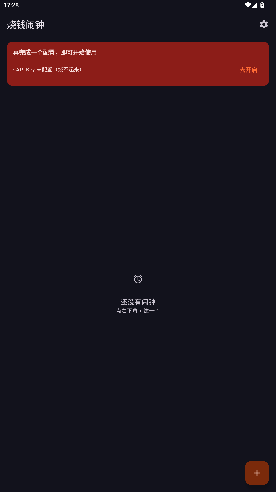
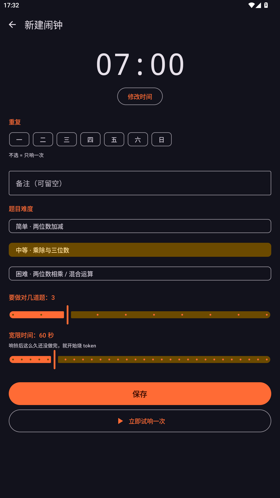
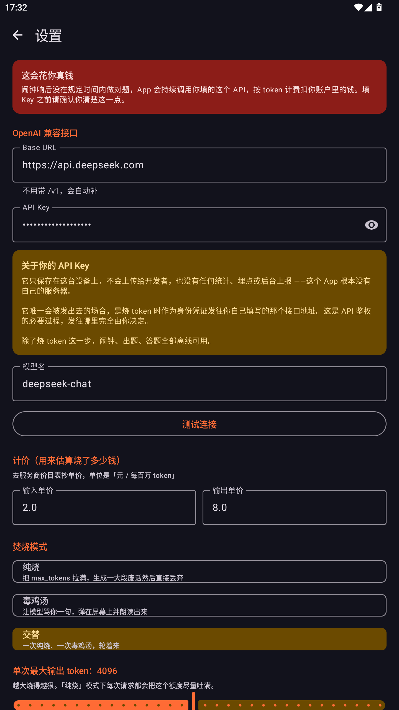
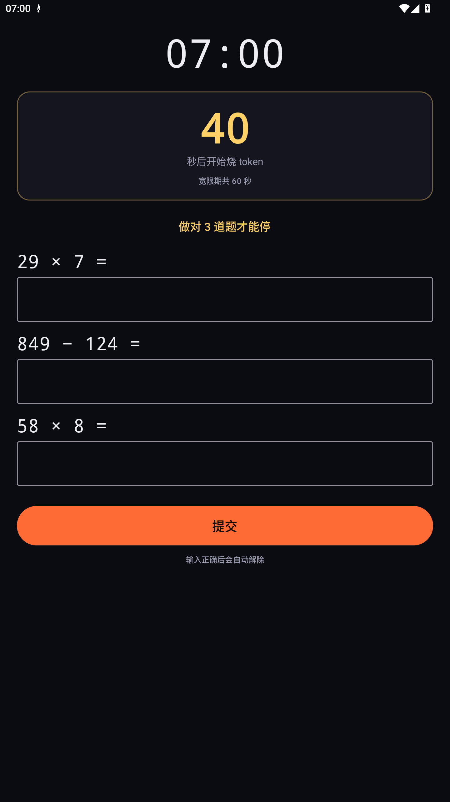
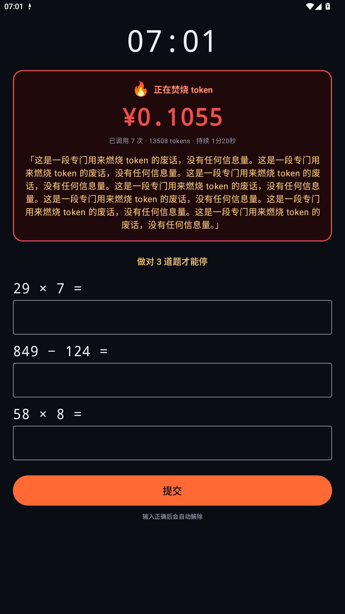
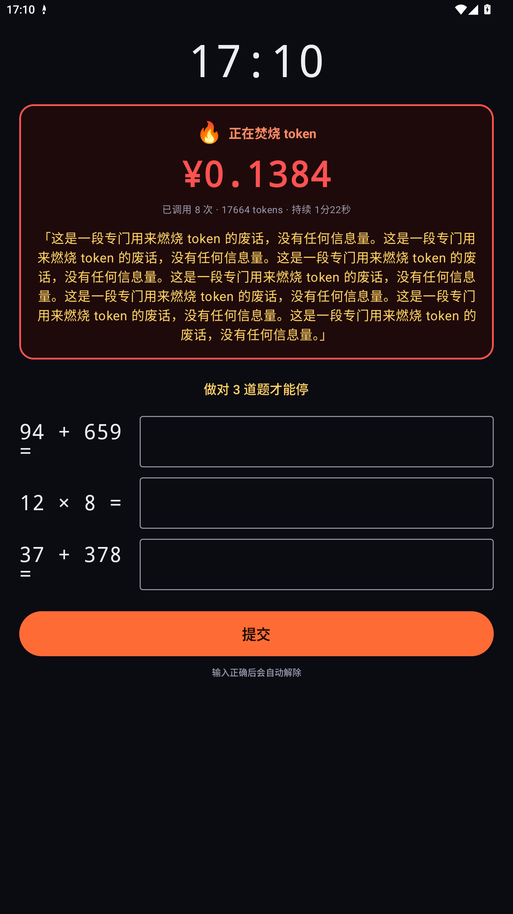
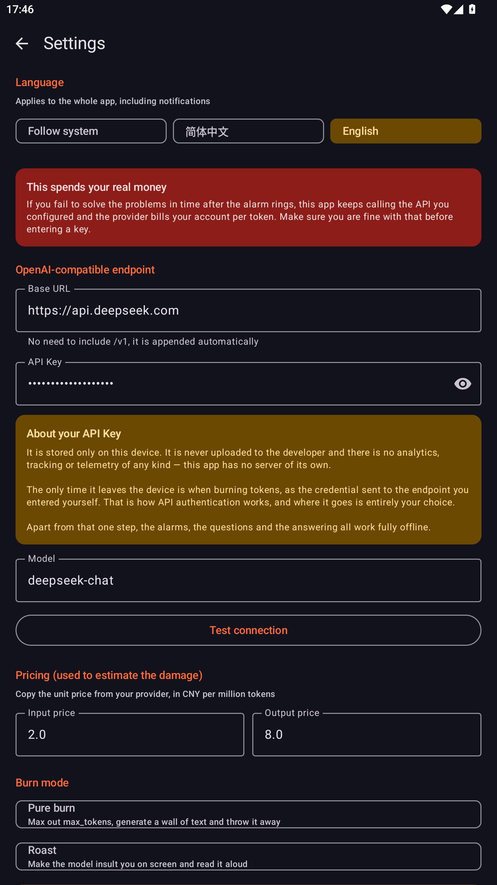
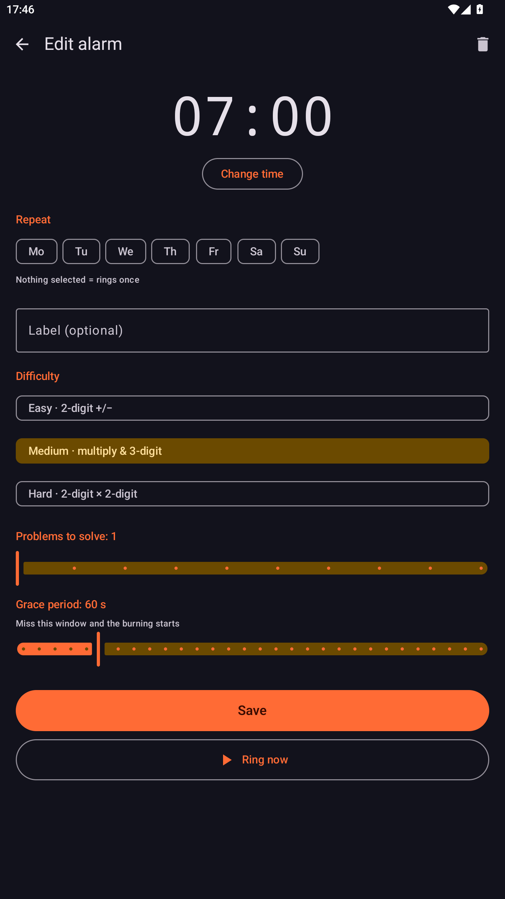
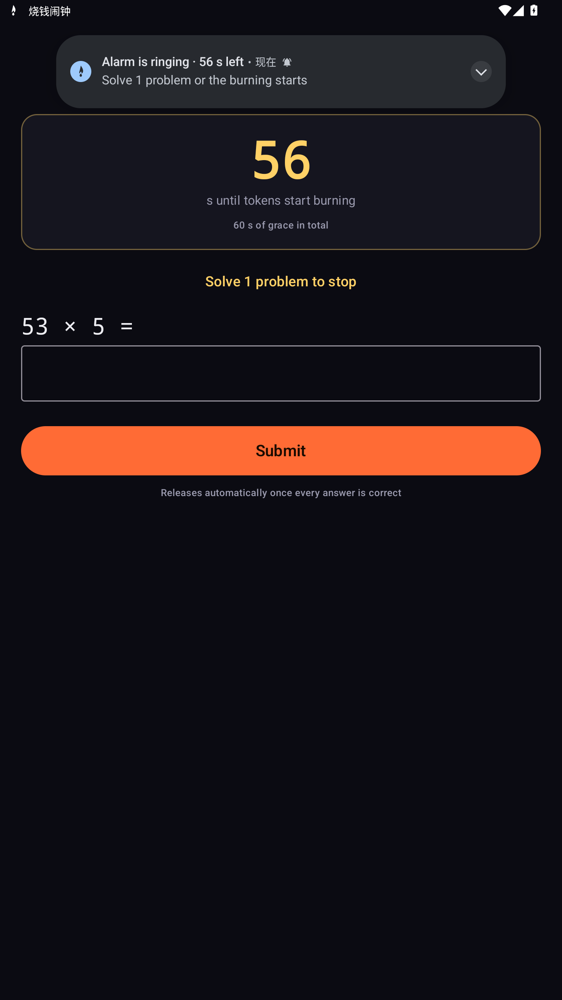

# 烧钱闹钟

[English](README.md) · **简体中文**

一个把你的真金白银押上去的安卓闹钟。

闹钟响了，你有 60 秒做对三道心算题。做不出来，App 就开始拿你自己的 LLM API 疯狂
输出，把 `max_tokens` 拉满，实时显示已经烧掉多少钱 —— `¥0.1384`，还在涨 —— 直到你把题做对。

> ⚠️ **它花的是你自己的钱。** 费用从你的 API 账户扣，扣了追不回来。
> 填 Key 之前请先读「跑飞保护」那一节。

---

## 界面

| 闹钟列表 | 新建闹钟 | 设置 |
|---|---|---|
|  |  |  |

| 锁屏响铃 | 锁屏焚烧 | 焚烧中 |
|---|---|---|
|  |  |  |

界面提供**简体中文与英文**，可以在 App 内切换（设置 → 语言），
Android 13+ 的系统「应用语言」里也能直接改。

| 设置（英文） | 新建闹钟（英文） | 响铃（英文） |
|---|---|---|
|  |  |  |

---

## 它是怎么工作的

```
AlarmManager.setAlarmClock()          ← 不受 Doze 批次延迟影响
        │
        ▼
AlarmReceiver（精确闹钟触发）
        ├─ 发「全屏 intent」通知   ──→ 覆盖锁屏，点亮屏幕
        ├─ startActivity 兜底      ──→ 被 Android 15 的 BAL 拦截，留着无害
        └─ 启动 BurnService（前台服务，mediaPlayback|dataSync）
                │
                ▼
        ┌──────────────────────────────────────────┐
        │ 阶段一 RINGING：响铃 + 震动 + 60 秒倒计时   │
        │         ↑ 全部答对 → 立即停止              │
        └──────────────────────────────────────────┘
                │ 倒计时归零仍未答对
                ▼
        ┌──────────────────────────────────────────┐
        │ 阶段二 BURNING：每 3 秒调一次 API，        │
        │ 实时累计 tokens 与估算花费                 │
        │   交替模式：毒鸡汤(200 tok) ↔ 纯烧(4096 tok)│
        └──────────────────────────────────────────┘
                │
                ▼ 答对题目 / 跑飞保护触发
             全部停止
```

关键设计：**状态放在单例 `BurnState` 里，前台服务负责推进，Activity 只负责渲染。**
两边谁先被杀都不影响对方，从通知点回来能立刻接上当前状态。

---

## 下载安装

去 [**Releases**](../../releases) 页面下载最新的 `BurnAlarm-x.y.apk` 直接侧载安装。

需要 **Android 8.0（API 26）** 或更高，目标 **Android 15（API 35）**。

有两项权限直接决定它管不管用：

- **精确闹钟** —— 它本身就是闹钟类应用，声明了 `USE_EXACT_ALARM`
- **锁屏全屏提醒** —— 这是它接管锁屏的方式

---

## 配置

设置页里有这几项：

| 项 | 说明 |
|---|---|
| Base URL | 任何 OpenAI 兼容地址。**不用带 `/v1`，会自动补。** 例：`https://api.deepseek.com` |
| API Key | 存在 App 私有 DataStore 里。除了发往你自己填的那个接口，不会去别的地方 |
| 模型名 | 例：`deepseek-chat` |
| 输入 / 输出单价 | 去服务商价目表抄，单位「元 / 每百万 token」。只用来**估算**屏幕上的金额 |
| 焚烧模式 | 纯烧 / 毒鸡汤 / 交替 |
| 单次最大输出 token | 256–8192。**这是烧钱速度的主要旋钮** |
| 焚烧间隔 | 1–60 秒一次 |
| 朗读毒鸡汤 | 用系统 TTS 把嘲讽念出来 |
| 连续焚烧上限 | 见下 |

页面上有 **测试连接** 按钮，底部还有一行实时估算：
*「按当前设置满负荷估算：约 ¥39.32 / 小时」*。保存前先看一眼。

### 跑飞保护

**这一项防的是「代码出 bug 导致无限循环」，不是防你。**

你选择「烧到答对为止」是合理的，所以默认**没有金额刹车**。
但如果哪天循环逻辑写错了，你睡着的时候它可能一直烧下去。
所以给一个时间上限兜底，默认 **120 分钟**，**设成 `0` 就完全关掉**。

给个数量级感受：按默认设置（4096 tokens、3 秒一次、¥8/百万输出）大约
**¥39/小时**；换成 GPT-4o 那一档单价就是 **约 $96/小时**。兜底就是为这个量级准备的。

---

## 隐私

**你的 API Key 只保存在这台设备上，不会上传给开发者，也没有任何统计、埋点或后台上报
—— 这个 App 根本没有自己的服务器。**

它唯一会被发出去的场合，是烧 token 时作为身份凭证发往**你自己填写的那个接口地址**。
这是 API 鉴权的必要过程，发往哪里完全由你决定。

除了烧 token 这一步，闹钟、出题、答题全部离线可用。

反过来说：「本软件无需联网」这种说法是不成立的 —— **烧 token 本身就必须联网**，
否则根本烧不起来。

---

## 从源码构建

前置条件：JDK 17+，Android SDK 含 platform 35 与 build-tools 35.0.0。

```bash
git clone git@github.com:Sauomore/Money-Burning-alarm-colok.git
cd Money-Burning-alarm-colok

# debug 包
./gradlew assembleDebug        # Windows: gradlew.bat assembleDebug

# 签名 release 包（可选）
cp keystore.properties.example keystore.properties   # 填入你自己的密钥库
./gradlew assembleRelease
```

没有 `keystore.properties` 时 release 包只是「未签名」，**构建不会失败**，
所以刚 clone 下来就能直接编译。

### 不想花钱先试一遍

`tools/mock_openai.py` 是一个极简的假 OpenAI 接口：

```bash
python tools/mock_openai.py 8765
```

然后把 Base URL 填成 `http://10.0.2.2:8765`（这是模拟器访问宿主机的地址），
API Key 随便填，点 **立即试响一次**。token 计数和金额会跟真的一样往上涨，但一分钱不扣。

---

## 技术栈

- Android Gradle Plugin `8.7.3`，Gradle `8.14`
- Kotlin `2.0.21`，Jetpack Compose（BOM `2024.10.01`），Material 3
- `compileSdk` / `targetSdk` 35，`minSdk` 26
- AppCompat（**只**为了 `setApplicationLocales`）、DataStore、OkHttp、kotlinx.serialization
- 导航用 `navigation-compose` `2.8.4`

---

## 踩过的坑（改代码前先看）

### 1. Android 15 硬拦后台启动 Activity

```
E ActivityTaskManager: Background activity launch blocked! goo.gle/android-bal
    [callingUidProcState: RECEIVER]              ← 精确闹钟不豁免
E ActivityTaskManager: Background activity launch blocked!
    [callingUidProcState: FOREGROUND_SERVICE]    ← 前台服务也不豁免
```

**精确闹钟和前台服务都不豁免 BAL。** 唯一能覆盖锁屏的正路是**全屏 intent 通知**，
见 `AlarmReceiver.postFullScreenNotification()`。
`startActivity` 那两处兜底会被静默拦掉（不抛异常），留着是为了在宽松 ROM 上多点机会。

### 2. 全屏 intent 只在「设备真的锁着」时才生效

系统只在通知**首次投递**的那一刻评估全屏 intent，且要求 `isKeyguardShowing == true`。

- **没有设锁屏密码的设备/模拟器**：设备从不进入 locked 状态 → 全屏 intent 永远不触发。
- **App 在前台时**：只弹横幅，不抢屏（这是正常行为）。
- 每秒 `notify()` 刷新同一 id **不会**重新触发全屏 intent。

真机上一定要设 PIN/图案锁，否则这 App 的强制力会大打折扣。

### 3. 工程路径不能含中文

AGP 在 Windows 上会直接拒绝非 ASCII 路径，所以本工程放在纯英文目录下。
别挪回中文目录。

### 4. 明文 HTTP 默认被禁

Android 9+ 默认拦明文。本 App 通过 `res/xml/network_security_config.xml` 放开了，
因为很多人会指向局域网的 Ollama / LM Studio。
代价是走 `http://` 时 API Key 明文传输 —— 设置页检测到会显式警告，公网请务必用 https。

### 5. PowerShell 脚本要 UTF-8 BOM

`build.ps1` 里有中文，Windows PowerShell 5.1 会按 GBK 读而乱码。
文件已带 UTF-8 BOM，**改的时候别把 BOM 弄丢**。

### 6. StateFlow 的占位默认值会吃掉用户配置

`AlarmViewModel.settings` 的初始值**必须**是 `null`，不能是 `AppSettings()`。

用 `AppSettings()` 当占位值时，设置页的 `LaunchedEffect` 会把这个「合成的默认值」
当成真实配置填进草稿，而真正的 DataStore 值是异步读出来的。
后果是：**用户进设置页、数据还没读完就按返回，已经存好的 API Key 会被默认值覆盖成空。**

修法：`stateIn(..., SharingStarted.Eagerly, null)`，`stored == null` 时只显示转圈不渲染表单，
返回按钮再加一道 `if (loaded)` 兜底。

---

## 已知限制

- 进程在焚烧途中被系统杀死后，焚烧不会自动恢复 —— `BurnService` 重启时拿不到
  `alarmId` 会直接收工，避免留下一个停不下来的前台服务。
- 部分国产 ROM 会拦全屏 intent。真遇到的话需要额外加 `SYSTEM_ALERT_WINDOW`
  悬浮窗兜底（先弹一个 1×1 悬浮窗让 `callingUidHasNonAppVisibleWindow` 为真，
  再启动 Activity）。当前未实现。
- 金额是按你填的单价**估算**的，不是账单。

---

## 目录结构

```
.
├── app/src/main/
│   ├── java/com/dsh/burnalarm/
│   │   ├── MainActivity.kt
│   │   ├── BurnAlarmApp.kt            通知渠道
│   │   ├── alarm/                     AlarmScheduler · AlarmReceiver · BootReceiver
│   │   ├── burn/                      BurnState · LlmClient · BurnService
│   │   ├── ring/RingActivity.kt       锁屏全屏响铃页 + 答题
│   │   ├── math/MathGenerator.kt      三档难度出题
│   │   ├── data/                      Alarm · AppSettings · AlarmRepository
│   │   ├── i18n/AppLocale.kt          应用内语言切换
│   │   └── ui/                        列表 · 编辑 · 设置 · 主题 · 文案映射
│   └── res/
│       ├── values/strings.xml         英文（默认）
│       ├── values-zh/strings.xml      简体中文
│       ├── xml/locales_config.xml
│       └── xml/network_security_config.xml
├── tools/mock_openai.py               假 API，零成本验证
├── docs/                              截图
├── keystore.properties.example
└── build.ps1                          一键构建脚本（Windows）
```

---

## 许可

[MIT](LICENSE)

随便用、随便改、随便发。只是账单别找别人，找你自己。
